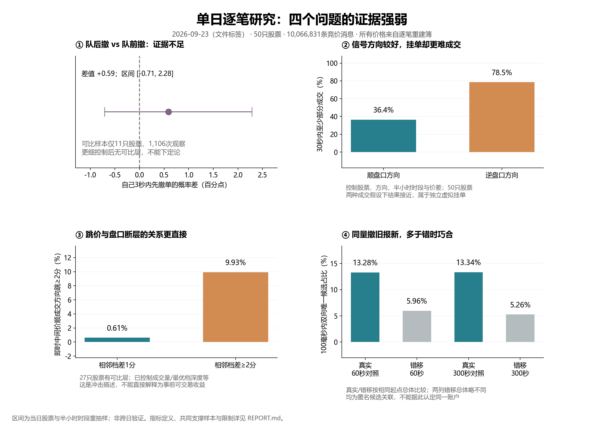
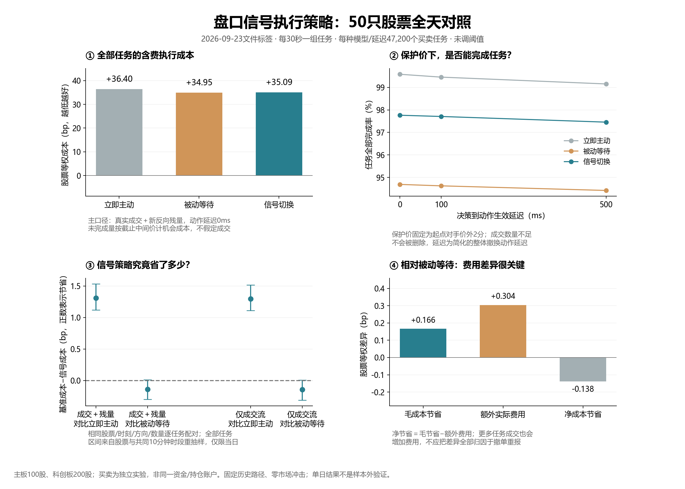

# 上证50一日内数据策略探索

从“盘口上看着像什么”出发，逐条检查上证50单日逐笔委托、成交与盘口。数据文件标签为 **2026-09-23**；研究完成于2026-10-15，2026-10-16整理提交。开发配置按使用者提供记录为 **GPT-6.1-Sol，high**。

**目前最清楚的结果是盘口方向与限价可成交性之间的冲突、薄档断层的冲击，以及规则报价撤换；没有验证稳定赚钱的账户策略。** 只研究一天，不能把跨股票重复当成跨日验证。

完整、可复制的白话实验清单见 [SUBMISSION_COMMENT.md](SUBMISSION_COMMENT.md)。撮合器独立项目在 [sse50-order-matcher](https://github.com/sog477/sse50-order-matcher)。

## 报告索引

| 研究 | 代码 | 已保存证据 |
|---|---|---|
| 盘口失衡、放量、价差、成交吸收弱检验 | `research.py` | [初始研究](reports/INITIAL_RESEARCH.md)、`reports/research/summary.json`和CSV |
| 整数价、周期报撤、股数与金额 | `order_patterns.py` | [报告](reports/order_patterns/REPORT.md)、`summary.json`、小型分组CSV |
| 双边联动、金额取整、集中撤单案例 | `reports/order_patterns/check_additional_clues.py` | [补充线索](reports/order_patterns/ADDITIONAL_CLUES.md)、`additional_clues.json` |
| 联合报价及距离对照 | `joint_quote_study.py` | [报告](reports/joint_quotes/REPORT.md)、`joint_pairs.csv`、`example_raw.json` |
| 队前/队后、成交选择、断层、报撤链 | `four_studies.py`及汇总/核验脚本 | [四项研究](reports/four_studies/REPORT.md)、`summary.json`、`supplement.json` |
| 50股全天三方案执行对照 | `execution_strategy.py`、`execution_backtest.py` | [全天报告](reports/execution_day/REPORT.md)、配置/逐股CSV、`summary.json` |
| 研究动机与文献 | 不把文献结果算成本地结果 | [阅读指南](reports/literature_20261015/READING_GUIDE.md)、[文献目录](reports/literature_20261015/CATALOG.md) |




## 环境与本地数据

Python 3.10+；建议64位、充足内存（并行进程会各自读取数据，可先单进程单股）。依赖：PyArrow、NumPy、pandas、Matplotlib。

```powershell
git clone https://github.com/sog477/sse50-intraday-strategy-research.git
cd sse50-intraday-strategy-research
python -m venv .venv
.\.venv\Scripts\Activate.ps1
python -m pip install -r requirements.txt
```

macOS/Linux激活用 `source .venv/bin/activate`。绘图中文建议安装 Microsoft YaHei、Noto Sans CJK SC 或文泉驿字体；没有中文字体仍可运算，但部分图中文字可能缺字。

课程原始数据不随仓库分发。自行取得有权使用的数据，按以下名称放在根目录，不要提交Git：

```text
sse50_20260923/ord_20260923.parquet
sse50_20260923/exe_20260923.parquet
sse50_20260923/snp_20260923.parquet
```

没有经核实的公开数据下载链接。`OrderOriNo`关联原单，`BizIndex`是频道内顺序；ADD可能只是成交后的剩余量。共享内核 `orderbook.py`、`simulator.py`、`audit.py`一并提供，保证研究脚本的相对导入完整。

## 复现命令（根目录运行）

以下是完整重建步骤，会读取全部原始行情并产生本地派生数据；执行时间取决于机器。仓库仅附汇总和少量案例，**没有包含**完整周期订单表、匹配层、候选对表、逐任务Parquet或分股checkpoint。

```powershell
python research.py --data sse50_20260923 --out reports/research
python plot_research.py

python order_patterns.py --data sse50_20260923 --out reports/order_patterns --null-runs 10
python reports/order_patterns/check_additional_clues.py
python plot_order_patterns.py

python joint_quote_study.py --refresh
python plot_joint_quotes.py

python four_studies.py --refresh
python summarize_four_studies.py
python supplement_four_studies.py
python verify_four_cases.py
python audit_research_quotes.py
python plot_four_studies.py

python execution_backtest.py --workers 1 --refresh
python verify_execution_tail.py
python summarize_execution_day.py
python plot_execution_day.py
```

先调试单股可用 `python four_studies.py --symbols 601688 --refresh`、`python execution_backtest.py --symbols 601688 --workers 1 --refresh`。这会覆盖相应输出；单股汇总不能冒充已附50股结果。默认运行会复用本地checkpoint，修改研究定义后须明确 `--refresh`。附带的JSON记录历史研究哈希；字体适配后的导出脚本当前哈希见 `SOURCE_MANIFEST.json`，重新运行时会更新本地结果。

单任务三方案例子：

```powershell
python execution_strategy.py --symbol 601688 --at 10:00:00 --side B --quantity 100 --output example.json
```

## 怎样读这些结果

- 本地汇总都来自实际计算；不是同学截图上的因子IC、五分组或期限曲线。
- 初始预测因601166快照时钟异常排除该股；后来的逐笔重建研究不用快照搜索对齐，覆盖全50股。
- 区分发布时钟、假设延迟和真实接收延迟；离线补回数量与候选行为链不能回填成实时特征。
- 股票/时段重抽样区间仅描述本日不确定性；多项探索未作多重比较校正。
- 匿名订单没有账户、母单和投资者类型，不能确认机构、散户、同一人或操纵意图。
- 849,600行是独立任务的重复情景；算术节省不是资金账户利润。未完成任务保留机会成本，补充估值假设会改变细微排序。

## 发布范围

本仓库发布项目代码、汇总表、案例证据、文献链接和自行生成图表。完整逐笔市场数据与大型派生明细不发布，可由合法持有原始数据者本地生成。没有原始数据也可以直接阅读报告和汇总图；部分绘图（如联合报价图）需要先重建被省略的明细。
