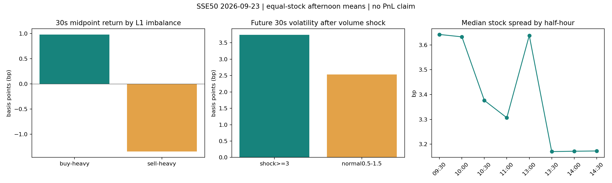

# 初始盘口研究（2026-10-15）

## 本地数据研究

`research.py` 分析 236,581 个有效连续竞价快照。预测部分因时间映射异常事先排除 601166，保留 49 股、23,211 个每股每时段至少相隔 30 秒的观测。信号和行情均假设在标签/事件时间后一秒才可观测；目标使用同一交易时段、目标时刻之前最近的报价，允许最多 4 秒报价龄，实际标签跨度约 26–30 秒。这个一秒是研究假设，不是已经测得的真实接收延迟。研究不使用审计里的状态搜索结果。

本轮固定阈值，没有网格寻优；读过同学同日结果，不能把本轮称作全盲发现或独立新数据验证。上午和下午分别报告；主结论以下午为准。置信区间采用股票与共同十分钟钟表区块交叉重采样，1000 次；它描述当日不确定性，无法取代跨日检验。

| 明确问题 | 下午实际结果 | 解释 |
|---|---|---|
| 买一量≥卖一9倍，未来30秒是否更易上涨？ | 买盘强组 37.12%，卖盘强组 17.74%；股票等权相差 19.38 个百分点 | 价格不变算未上涨，37%不能写成“上涨胜率超过50%” |
| 上述两组中间价变化 | +0.984 / −1.347 bp；差 2.331 bp，区间 [1.534,3.324] | 46 股两组各至少5个观测；预测关系不是成交利润 |
| 过去30秒放量≥此前5分钟基准的3倍，未来波动是否升高？ | 未来30秒实现波动 3.746 vs 2.534 bp，差 1.212，区间 [0.564,1.938] | 对照是基准0.5–1.5倍，42股满足样本要求；上午差值区间跨零 |
| 放量只是在预测下一轮波动吗？ | 放量组过去30秒波动 6.995 bp，未来降到3.746 bp | 大部分价格运动已经发生，成交活跃有同期与持续性；不能解读成放量造成未来上涨 |
| 价差是否有固定的日内 U 形？ | 各股半小时价差中位数的横截面中位数：09:30 3.642、11:00 3.307、13:00 3.638、14:30 3.173 bp | 开盘与午后重开较宽，本日尾盘没有明显再扩大；不能预设 U 形一定成立 |

最有市场机制意味的反直觉结果是“盘口厚也可能交易成本高”。11 只日内中位价格低于10元的股票，双边一档挂量中位数约247.8万股，但相对价差中位数16.35bp；11只百元以上股票对应约1347.5股、1.39bp。全样本78.71%的快照只有一分钱价差。低价股的大队列部分来自最小价位不能再缩小的制度约束，不能用股数厚度替代执行成本。

原始分组均值在 `research/conditional_results.csv`；股票等权与区间在 `research/summary.json`。图中前两个面板展示下午符合两组样本要求的股票等权均值；半小时图不将各股不同快照数量当作权重。`research/stock_liquidity.csv` 和 `research/intraday_spread.csv` 可复核价差与深度结果。

## 值得做的机制型方向

1. **计划交易的执行选择**：已经决定买入固定股数，研究何时用市价吃单、何时限价排队，而非由微弱信号频繁开平仓。固定30秒完成期限，比较相同股数、相同基准下的真实报价成本和未完成风险；只有当预期不利移动足以补偿价差与费用时才加快执行。它直接对应价格时间优先、排队和 tick 成本，且避免新买股票当日卖出的假设。[gry1024 的执行研究](https://github.com/gry1024/sse50-level2-research)有相同思路，但其延迟执行在留出股票失败，不能照搬为盈利策略。
2. **持久大单附近改善报价**：一分钱价差不能合法在中间插入报价；价差至少两分钱时，改善一分钱才能获得价格优先，价值是改变排队位置。需要真实队列、挂单存续、撤单退出、T+1底仓和逆向选择一起建模。[Peida-Lee 的讨论](https://github.com/aslan9/pku_quantllm/issues/6#issuecomment-6080768356)提供线索，但50ms与200ms结果反向、多个情景比较和单日下午样本都说明稳定性未成立。
3. **成交被吸收后的补单反转**：逻辑是强买入仍推不高价格，卖方同价持续补单，可能有隐藏供应。本地先检验了弱版本：30秒方向成交差绝对值≥0.6、成交量倍数≥2，比较同向价格没有进展与前进至少一分钱。下午符合两组最低样本数的仅2股27个观测，未来同向变化差的区间 [−3.14,4.60] bp，未支持反转。未前进组中位价差15.16bp，对照2.67bp，存在明显 tick 和流动性混杂。必须进一步观察逐笔同价补单和真实队列，不能把“大单后反向”直接写成策略。

更有说服力的后续证据应来自冻结规则后的多交易日、同价位同流动性对照，以及交易成本后的执行结果。此处交付的是可复现的行情规律与未成立假设，没有声称发现稳定套利。
