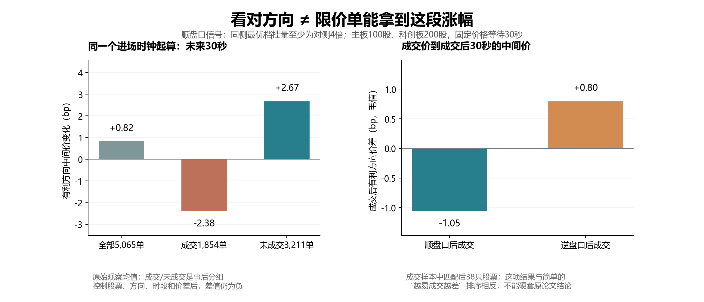

# 四项逐笔研究：队列位置、成交选择、盘口断层与撤单行为链

研究日期：2026-10-15。数据日期 **2026-09-23 仅按文件标签识别**。本地50只股票，共 **10,066,831 条竞价消息**，已逐股完整重放；订单关联、方向、数量扣减及研究中的队列数量守恒检查全部通过。原始数据未改动。本次没有修改撮合程序或增加界面功能。

## 先看结论

| 问题 | 本日观察 | 证据判断 |
|---|---|---|
| 队后撤单是否比队前撤单更容易促使自己撤单？ | 可比样本中3秒内自身先撤单的概率差为 **+0.59个百分点**，区间 **−0.71至+2.28个百分点** | **不能确认**。仅11只股票、1,106次可比观察，细化控制后没有合格可比层 |
| 看涨信号能否被限价买单赚到？ | 顺盘口方向的虚拟挂单整体未来30秒变化 **+0.82bp**；其中成交组却是 **−2.38bp**，未成交组 **+2.67bp** | **有明显成交选择**。看对方向的行情，常常没有成交；不能直接转成策略收益 |
| 小成交能否比大成交引起更大跳价？ | 控制股票、方向、时段、价差后，小成交＋大断层的即时≥2分跳价概率 **9.13%**，大成交＋密集盘口 **3.50%** | **支持盘口结构比绝对成交量更直接的解释**。机械跳价与未来预测仍须分开 |
| 频繁撤单是不是退出？ | 100毫秒内找到 **228,797 条**同方向、同数量且双向唯一的后续候选；追价121,819条，转为无ADD主动成交26,565条 | **许多候选像在重新争取成交**，但匿名数据不能证明同一账户；错时匹配也有约5%–6%的候选 |

这里的“顺盘口方向”：买单对应买一挂量至少为卖一4倍；卖单对应卖一挂量至少为买一4倍。卖出指标统一反号，以正数代表对该方向有利。1bp=0.01%；1tick=1分钱；中间价允许半分钱。


## 数据和时间口径

- `ord` 用 `OrderOriNo` 关联订单，`exe` 用 `BidOrder` / `AskOrder` 关联。每股在其频道内按 `BizIndex` 排序，检查序号唯一、时间不倒退。
- **历史簿消费真实成交，不把残余ADD当作原始新单重新撮合。** 全部立即成交而没有ADD的主动单也纳入成交包及行为链研究。
- 每个研究只取连续竞价09:30–11:30、13:00–14:57的完整观察窗口；午休、集合竞价和15:00后的2,463笔盘后成交不混入研究。
- 中间价直接来自逐笔重建簿，未来目标时点取不晚于该时刻的最近有效双边报价中间价；只有买一低于卖一、两边均存在才记为有效。没有用搜索快照对应时刻的办法，也没有用未来快照覆盖簿。相同毫秒内按消息序号处理，时钟采样在该毫秒全部消息之后进行。若某目标时点处于无有效双边报价的消息间隙，计算会沿用此前有效中间价，不会从未来取值。
- 这是消息发布时间下的历史研究，没有接收时间、发送时间和网络延迟。逐笔Trade后、残余ADD前的簿可能短暂不同于完整申报处理后的状态，所以同时报告1秒后结果。
- 50只股票是该数据文件中的50个代码；本次没有独立核验历史指数成分或数据供应商的原始来源。

另用独立脚本重新重放全部50股：连续竞价每条消息后，以及每个毫秒标签处理结束后，双边报价缺失、买卖价锁定或交叉的状态数均为 **0**。因此本日连续竞价研究没有因为无效双边报价而沿用旧中间价；这项检查不验证真实接收延迟，也不消除Trade与残余ADD之间的有效但短暂的盘口状态。

### 可比样本与不确定性

对比先在同股票、方向、半小时时段等条件下分层，只保留两组都有足够观察的层；每层按两组较小样本量加权，最后等权平均股票。默认每层每组至少3次，每股匹配权重至少5；特别注明的成交样本比较用至少2次，跨大小成交比较用至少5次。

报告的95%区间来自 **1,000次股票与半小时时段交叉重抽样**，只描述当日不确定性，不能替代独立交易日验证。四个方向包含多个指标、多个期限，没有做多重比较校正，不把这些区间解释为策略发现的确认性检验。`PLAN.json` 在本次全样本汇总前写下定义，但已看过同一天的其他研究，不能称为预注册或真正样本外检验。`supplement.json` 明确标注为看到主结果后增加的探索性检查。

## 一、队前撤与队后撤：目前不能下定论

论文切口是把同价队列中的前方、后方深度分开，而不只看总挂量变化。原论文有更丰富的交易者信息；本研究只观察匿名订单的行为，不能复原其动机。[Dahlström等，The determinants of limit order cancellations，2024卷期](https://onlinelibrary.wiley.com/doi/10.1111/fire.12363)

### 做法

每5秒、每股每侧，从最优档存活订单中均匀随机抽一笔；观察其后1秒其他同价订单的撤单及成交。只有目标自身数量不变、同侧最优价在这1秒内始终不变，才进入下一阶段。在这个时点以后，观察1/3/10秒内目标的**首次减量**是撤单还是成交。

共 **209,423** 次合格观察。它们是存活订单的条件样本，不能代表全部新订单，也不是按挂单股数加权。3秒结果窗口对同股同侧不重叠；10秒会重叠。首次减量可能是部分撤单或部分成交，不等于整笔订单最终终结。

| 前1秒的同价撤单 | 观察数 | 自身3秒内先撤单 | 自身3秒内先成交 |
|---|---:|---:|---:|
| 仅队前撤 | 6,831 | 1.70% | 10.28% |
| 仅队后撤 | 11,596 | 1.13% | 7.70% |
| 前后都撤 | 1,187 | 3.12% | 7.41% |
| 均未撤 | 189,809 | 1.59% | 19.54% |

**直接比较原始均值会给出相反印象。** 仅队前撤组的队前数量占比中位数79.9%，仅队后撤组39.3%；二者本来就处在不同位置。

控制股票、方向、半小时、价差、队前数量占比四分位、撤单占整档比例、订单年龄、是否同时有成交后，仅剩 **115个层、11只股票**；队后组626次、队前组480次。自身3秒内先撤单的等股权概率分别 **0.704% vs 0.114%**，差 **+0.591个百分点**，95%区间 **[−0.709,+2.283]个百分点**。无同时成交子样本的差值+0.515个百分点，区间仍跨零。

把位置细化到十分位，并进一步控制整档深度和目标数量的log2分组后，**没有合格可比层**。因此无法排除队列位置、订单大小、样本稀疏的解释。不能宣称已验证“队后撤单是在发出坏消息”。

**本项结果是证据不足。** 下一步最需要增加交易日和连续的队列风险样本，不宜通过反复换阈值寻找一个正结果。

## 二、看对方向的限价单，主要在哪些行情里成交？

原论文用币安永续的小额实盘挂单讨论成交概率与成交后回报。我们借用问题，没有把币安结果当成A股结论，也没有把历史虚拟成交当作真实实验。[Albers等，The Market Maker’s Dilemma，2025](https://arxiv.org/abs/2502.18625)

### 做法

每60秒，在买一、卖一分别挂一笔独立虚拟单：主板100股、科创板200股，排在当前同价队尾，价格固定，最长等待30秒，未成交部分到期撤销。每种模型 **23,500笔**，合计 **47,000个情景**，不是47,000笔同时共享资金或容量的真实下单。

两种替代假设分别计算：

1. `tape_only`：前方队列按真实订单减量；真实成交打到后来排入的同价订单，或成交穿过虚拟价格时，才给虚拟单成交。
2. `with_residual`：另外允许新出现的反向残余ADD穿过虚拟价格时成交该残余量。

前方撤单只减少排队量，本身不会造成成交。虚拟单不修改历史簿；历史参与者也不会对虚拟单反应。两模型不是严格上下界，23,500个同起点情景中 **0.383%** 的最终成交量不同。

### 发现一：信号与可成交性相冲突

以下为`tape_only`原始观察均值：

| 信号相对下单方向 | 起点数 | 30秒至少部分成交 | 首次成交等待中位数（成交者） | 起点到30秒的方向性中间价变化 |
|---|---:|---:|---:|---:|
| 顺盘口 | 5,065 | **36.60%** | 6.755秒 | **+0.824bp** |
| 中间 | 13,370 | 46.42% | 5.845秒 | 0.000bp |
| 逆盘口 | 5,065 | **73.82%** | 3.280秒 | **−0.824bp** |

同一时钟同时观察两侧，所以有利方向的符号对称是设计结果，不是两份独立证据。

匹配股票、方向、半小时和价差后，两组各3,093次，覆盖50只股票：顺盘口成交率 **36.39%**，逆盘口 **78.52%**；差 **42.13个百分点**，区间 **[32.52,50.68]个百分点**，49/50只股票为同一方向。替代模型分别36.56%、79.02%，差42.46个百分点。

### 发现二：实际成交的子样本，错过了“看对方向”的平均行情

只看顺盘口5,065个起点，仍从**同一个进场时钟**计算未来30秒价格变化：

| 事后是否成交 | 起点数 | 起点到30秒的方向性变化 |
|---|---:|---:|
| 成交 | 1,854 | **−2.379bp** |
| 未成交 | 3,211 | **+2.674bp** |
| 全部 | 5,065 | **+0.824bp** |

也就是：盘口提示上涨时挂买一，涨得顺的那部分行情经常买不到；后来能买到的那部分，价格路径往往已经不利。**这正是不能只用信号的预测均值来推算限价策略收益的原因。**

探索性地进一步在顺盘口组内匹配股票、方向、时段、价差后，成交与未成交的未来变化差 **−5.412bp**，当日区间 **[−7.399,−3.514]bp**；仅22只股票、成交316次/未成交336次。成交是事后分组，差异包含路径选择，不能理解为“成交导致下跌”。



### 没有照搬成功的部分

若改为从**真实虚拟成交价**算到**成交后30秒中间价**，在成交样本中匹配股票、方向、半小时和价差后，38只股票的顺盘口组为 **−1.053bp**，逆盘口组 **+0.797bp**；逆减顺 **+1.850bp**，区间 **[0.227,3.555]bp**。扣除成交瞬间中间价变化后，后续漂移分别−2.610bp和−0.383bp。

因此本日没有呈现简单的“成交概率越大，成交后的毛表现越差”排序。相反，逆盘口更容易成交，条件毛表现也较好。可能包含点差收益、不同的成交时机和样本组成，不能硬套原论文。

### 费用和可交易性

按程序现有假设：佣金万2、每单最低5元，另有双边过户费万0.1和卖出印花税万5。最低佣金对100/200股小单影响很大。原始成交样本中，顺盘口和逆盘口的30秒markout扣**单侧入场费用**后分别 **−13.62bp、−23.09bp**。这既不是完整往返费用，也不是可实现平仓收益；没有把中间价当成能直接成交的价格，也没有验证T+1、库存和对冲下的策略盈利。

## 三、小成交、大断层：价格冲击取决于“后面有没有人接”

Farmer等强调，最优档之后的空档是理解大跳价的关键。这个问题适合逐笔簿，因为只看成交量看不到被移走最优档后露出的下一档。[What really causes large price changes?，2004修订](https://arxiv.org/abs/cond-mat/0312703)

### 做法

按主动订单ID及方向合并其成交消息为“主动成交包”，检查其在成交流中连续且耗时≤1秒。全样本未发现非连续包；成交流连续不保证消息流连续，成交腿之间可能夹杂新增或撤单。因此包前后变化仍可能包含这些消息的影响。**成交包数量是实际执行量，不是原始申报量。**

每股09:30–10:00的成交包数量Q25/Q75定出小/大成交阈值；阈值冻结，10:00以后每5个包取1个，并保留完整后续30秒。小包≤Q25；大包≥Q75且>Q25，避免分位数相同造成重叠。共 **274,590** 个采样包。

冲击定义为成交包之前、最后一笔Trade之后的中间价变化，并按主动方向反号；断层是初始被动侧最优档到下一档的价格差。即时冲击、1秒后的累计变化、成交包后1/5/30秒漂移分别统计。

### 两个对比

**对比A：尽量控制吃掉的深度相同。** 匹配股票、方向、半小时、价差、成交大小组及“成交包数量/初始最优档数量”分组后，有27只股票、2,294层；大断层24,302个包、密集盘口53,411个包。

| 匹配后等股权指标 | 断层≥2分 | 相邻档差1分 | 差异与当日95%区间 |
|---|---:|---:|---:|
| 即时平均方向性中间价变化 | 0.725分 | 0.155分 | **+0.570分 [0.248,1.039]** |
| 即时方向性跳价≥2分的概率 | **9.93%** | **0.61%** | **+9.32个百分点 [5.31,14.18]** |
| 初始最优档被吃穿的概率 | 22.10% | 20.99% | +1.11个百分点，区间略跨零 |
| 起点至1秒后的平均方向性变化 | 2.338分 | 0.748分 | +1.590分 [0.865,2.710] |

平均bp冲击差仍为 **+0.253bp [0.162,0.359]**，所以不只是高价股用“分”计价显得变化大。去掉6只科创板后，21只可比主板股票的即时跳价概率差仍为 **+5.11个百分点 [1.83,9.24]**。这些是探索性稳健性检查。

**对比B：小成交＋大断层 vs 大成交＋密集盘口。** 匹配股票、方向、半小时、价差，有26只股票；两组15,235/16,239个包。即时平均冲击 **0.688分 vs 0.458分**，差 **+0.231分 [0.048,0.485]**；即时≥2分跳价概率 **9.13% vs 3.50%**，差 **+5.63个百分点 [2.82,9.14]**。此对比没有再匹配相对深度，因此它同时展示小包在薄档上也可能“很大”，不能把差异全部归因于一个空档变量。

### 原始事件复核的两个例子

- **688256，13:17:25.100**：155股主动卖成交包；初始买一1110.00元、155股，下一买档1108.00元，卖一1110.01元。买一被吃完后，买一变1108.00元，卖一仍1110.01元；中间价从1110.005降到1109.005，下降 **1.00元**。这是报价中点跳变，并不表示155股都在差1元的位置成交。包后1秒，方向性累计中间价变化为1.79元。
- **601668，13:45:12.900**：1,000,000股主动买成交包；包前后买一4.29、卖一4.30元，**中间价不变**。

两个例子都重新读取原始成交，重新重放至对应`BizIndex`，核对包ID、总数量、初始深度、前后BBO。它们是结果中挑出的说明案例，不是独立检验。

### 哪部分仍不能解释为预测能力

1. 最优档被拿走后，中间价机械变化与空档大小有直接算术关系，本身不是套利。
2. 即时Trade后的状态可能尚未包含同一主动单的残余ADD；1秒结果缓解这种短暂状态问题，却也混入后来其他订单和成交。
3. 在**已经吃穿最优档**的子样本中重新匹配，断层对包后1/5/30秒新增漂移的差异区间都跨零。例如30秒差+0.495分，区间[−0.450,+1.678]。没有足够证据宣称“看到吃穿＋断层，再追单仍能获得超额收益”。这个子样本本身也按事后结果筛选。

**本项最可靠的启发是成交风险和冲击解释：估计大单冲击时，需要看将被暴露的下一档和相对深度。** 尚未构建或验证基于断层的盈利策略。

## 四、撤单后的100毫秒：追价、补回、退后和转主动

Hasbrouck、Saar的论文把消息之间的联系用于研究流动性提供。我们借鉴“报撤链”，没有把所有短寿命单判成虚假挂单。[Technology and liquidity provision，2009作者稿](https://pages.stern.nyu.edu/~jhasbrou/Research/Working%20Papers/HS6.pdf)；[Low-latency trading，2013](https://pages.stern.nyu.edu/~jhasbrou/Research/lowLatencyTrading/lowLatencyTradingHasbrouckSaarJFM.pdf)

### 候选关联方法

起点是连续竞价中撤掉**当时全部剩余量**的订单，并保证后面31秒的完整窗口。主口径寻找随后100毫秒内，同股同方向、数量相同的新候选；必须新消息序号在撤单之后。只有“旧单恰好一个新候选，且新候选也恰好一个旧单候选”时才保留。另算20/1000毫秒及双向时间窗敏感性。

新候选包括两类：

- 有ADD的单：新数量=ADD残余量+ADD前已经发生的该单成交量；用第一条可见消息定位。追价/退后按其**残余报价**相对旧价定义，不保证等于原始申报价。
- 没有ADD的主动成交单：用其实际成交总量关联；不能恢复原始限价，单列`active_no_ADD`，不能断言是市价申报。

**这是一种事后重建的匿名候选链。** 有些新单的数量要等后续ADD才知道；不能当成实时识别同一交易者。为避免事后选例强行连接，歧义全部保留，不选择“看起来最像”的一个。

### 主结果

| 100毫秒主口径 | 次数 | 新候选30秒内有成交的比例 |
|---|---:|---:|
| 追价：买价提高/卖价降低 | **121,819** | **24.06%** |
| 退后：买价降低/卖价提高 | **74,476** | **1.01%** |
| 同价补回 | **5,937** | **18.49%** |
| 后续单只有主动成交、无ADD | **26,565** | 100%，由该分类定义决定 |
| 候选不唯一 | 215,618 | 无法归属，不统计结果 |
| 窗内无兼容候选 | 1,282,382 | 无法归属，不统计结果 |
| 总起点 | **1,726,797** | — |

四类双向唯一候选共 **228,797条，占13.25%**。其中追价或无ADD主动成交共148,384条，占唯一候选 **64.85%**。30秒成交指标从新单**首次可见消息**起算，包含ADD前的成交；不同分类处在不同价格位置，所以24.06%和1.01%是行为描述，不能解释为“追价的因果收益”。

找不到兼容候选不代表退出：也可能改量、跨过窗口、改向，或者本来就没有母单关系。主动无ADD类100%成交是筛选定义，不是100%命中的交易信号。

### 巧合会有多少？做了错时对照

把同一撤单起点向后平移60秒或300秒，再找同方向、同数量、100毫秒内的双向唯一新候选。每个比较只用真实与错移都具有完整观察期的同一批起点。

| 对照 | 共同起点数 | 真实相邻候选率 | 错移候选率 | 等股权差 |
|---|---:|---:|---:|---:|
| +60秒 | 1,706,628 | **13.28%** | **5.96%** | **+5.96个百分点** |
| +300秒 | 1,642,911 | **13.34%** | **5.26%** | **+6.44个百分点** |

50/50只股票的真实候选率高于两种错时对照。探索性按股票重抽样得到等股权差的当日区间分别 **[4.38,7.84]** 和 **[4.67,8.55]个百分点**。

时间窗敏感性：同一批+60秒对照起点下，20毫秒的真实/错移候选率为 **6.81%/3.79%**，1000毫秒为 **14.94%/9.11%**；两种窗口也是50/50只股票的真实候选率更高。扩大窗口同时增加巧合与歧义，不会自动提高关联可信度。

真实相邻确实比错时更集中，但错时仍有大量匹配；错时对照不是正式误识别率估计，不能把两者相减后的每条链认定为真实同一交易者。100股单尤其拥挤：450,993个起点里121,527个候选有歧义（26.95%），而≥10,000股55,343个起点仅187个有歧义（0.34%）；后者找到候选也很少，不能只根据低歧义判定真实性。

### 核对过原始消息的例子（600028）

| 撤单时刻 | 旧单→新候选 | 数量 | 时间差 | 行为与之后30秒 |
|---|---|---:|---:|---|
| 10:01:17.140 | 4930363→4946680 | 166,000股 | 40ms | 买价5.33→5.34元；新单30秒内全部成交 |
| 13:51:27.570 | 12055316→12143447 | 29,600股 | 50ms | 撤5.29元买单后出现同量主动买成交，VWAP5.31元，无ADD |
| 13:58:48.030 | 12056432→12418937 | 50,000股 | 30ms | 买价5.29→5.27元；30秒内无成交 |
| 14:47:51.570 | 14730181→14737909 | 50,000股 | 90ms | 买价仍5.29元；30秒内无成交 |

已重新读取原始委托和成交，核对数量、方向、事件顺序、时间差和分类。案例仍然是候选关联，不能认定同一账户，更不能由此区分个人和机构。

## 最值得继续做什么

**第一优先：把“信号是否正确”与“什么行情里能成交”联合起来。** 本日最有用的发现是顺盘口挂单的成交选择：预测正确的平均路径，不等于成交者拿到的路径。后续用其他交易日冻结阈值，联合检查成交率、等待时间、成交后价格和费用，才可能形成可交易规则。

**第二优先：撤单后的行为链。** 对同量追价和共同撤换建立更严格的相邻事件证据，再用改量、拥挤程度、错时对照及跨日复现评估。只称“程序化行为线索”，身份无法从这份匿名数据确定。

**第三优先：把断层用作执行风险指标。** 少看绝对成交量，多看相对最优档深度、下一档距离及补单速度。此次已证实的主要是冲击机制，尚未证实看到冲击后还能赚钱。

队前/队后方向暂不扩张故事。增加数据之前，先承认当前可比样本不足。

## 文件与复现

| 文件 | 内容 |
|---|---|
| `summary.json` | 全50股主结果、逐股数量、每项可比层/股票效应、当日重抽样区间 |
| `supplement.json` | 事后增加的成交选择匹配、bp归一化、主板子样本、错移股票重抽样 |
| `verified_cases.json` | 直接用原始消息复核的6个说明案例 |
| `quote_validity_audit.json` | 独立重新重放检查连续竞价双边报价是否缺失、锁定或交叉 |
| `queue_groups.csv` / `maker_groups.csv` / `shock_cells.csv` | 未匹配描述统计，不能与匹配后指标混用 |
| `maker_selection.csv` | 从相同起点计算的成交/未成交未来变化 |
| `replacement_groups.csv` | 所有时间窗、对称设定及错时结果；无归属行的0值只是未赋结果，应按分类过滤 |
| `replacement_shift_diagnostics.csv` | 每股相同起点总体下的真实/错移候选计数 |
| `replacement_quantity_groups.csv` | 数量分组与关联歧义 |
| `stock_*.json` | 每股重放完成检查点 |
| `*.parquet` | 本地逐股研究样本与合并样本，已加入git忽略；不等于原始数据 |

项目根目录运行：

```powershell
python four_studies.py
python summarize_four_studies.py
python supplement_four_studies.py
python verify_four_cases.py
python audit_research_quotes.py
python plot_four_studies.py
```

数据处理需要pandas、numpy、pyarrow，画图需要matplotlib。数据处理和绘图的依赖均见 requirements.txt。采集脚本默认复用`stock_*.json`检查点；修改研究定义后需显式`--refresh`，避免混用旧缓存。`preview_summary.json`仅为中间44股诊断结果，最终以`summary.json`为准。
