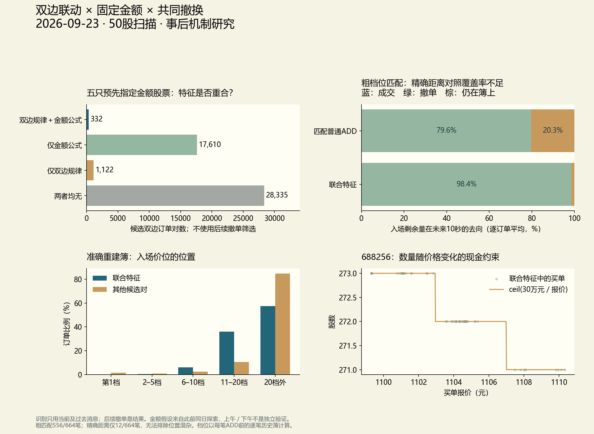

# 双边联动、固定金额与共同撤换：联合机制研究

数据日2026-09-23，研究日2026-10-15。

## 结论

**三个特征确实会出现在同一批订单上，最明显的是远档双边报价的循环刷新。**严格规则在5只股票中筛出332对；321对出现前后20毫秒内，上一对同类报价已两边全撤。这支持“旧报价退出、新报价接替”的形态解释，不能把累计新增挂量当作持续买入或卖出。

**低成交率的大部分直观解释来自报价位置。**87.05%的联合样本两边都在十档之外，买侧入场档位中位数31、卖侧18；没有一对两边都在前十档。不能把这些结果直接用于买一卖一的方向因子。

粗档位匹配显示较快撤单；精确到同一报价距离后，足够对照仅覆盖12/664笔。**本轮尚不能证明联合特征本身导致较快撤单、较低成交或策略收益。**不能以大量重复订单代替独立交易日的验证。



## 1. 样本、规则与时序

扫描全部50股的4,288,027条连续竞价ADD，得到67,491对候选：同股票、同频道、相同消息时间标签、原始订单ID相差1且买卖方向相反。同一订单只配一次，冲突按业务序号确定性处理。邻近ID与同一时间不等于同一账户。

在候选内定义双边联动：双方总观察数量相等；同频道、同双方数量、同30分钟区块内，当前及之前3对候选的3个间隔均为正，均值0.5–60秒，间隔变异系数≤3%；4对报价的双边间距为正，最大最小差≤1分钱。仅使用当前和此前消息，不要求未来继续规律，也不按后续是否撤单筛选。

固定金额沿用上一轮已经发现的假设：688008/688041/688111为10万元，688012为20万元，688256为30万元。要求买方总观察数量精确等于`ceil(金额/买方报价)`，整数分运算；联合规则同时要求买卖同量。卖方不被要求按卖价另算相同现金门槛。其他45股的金额参数未知，不能据此称它们没有金额规则。

历史逐笔以频道BizIndex排序，`OrderOriNo`关联，修复ADD前已成交量。总观察量只用来描述已披露订单的金额规则；未来容量去向的分母始终是**ADD实际剩余挂量**，不把ADD前成交再次记为未来成交。完全立即成交而没有ADD的原始主动订单不在本研究样本内。

盘口位置逐条重放真实Order/Trade，在每笔ADD入场前计算同侧价格档位和距离同侧最优价的tick数；没有使用原始快照搜索对齐，也没有快照覆盖。首个同侧价格或更优的新价算第1档。每对两条腿分别在各自ADD前观察，不宣称测得同时接收的真实延迟。

后续1/3/10秒分别累计关联成交及撤单数量；休市前最后10秒不进入结果比较，避免观察窗口截断。共同撤销指两边ADD挂量都全撤、没有ADD后成交，且最后撤单时间标签差≤20毫秒。撤单属于结果，不参与联合识别。联合样本全部在ADD后1秒内没有任何成交或撤单扣减，因此本次没有前一条腿在同时间标签两条ADD之间已经被减量的问题。

这些规则是本轮扫描前固定的研究定义，但金额假设和部分形态已在同一天见过；**不是事前注册，更不是独立留出日验证**。

## 2. 联合特征在哪里重合？

| 股票 | 金额规则 | 联合订单对 | 10秒内双边全撤、无ADD后成交 |
|---|---:|---:|---:|
| 688008 | 10万元 | 98 | 93.88% |
| 688012 | 20万元 | 71 | 100.00% |
| 688041 | 10万元 | 79 | 94.94% |
| 688111 | 10万元 | 31 | 93.55% |
| 688256 | 30万元 | 53 | 100.00% |
| 合计 | — | **332** | **96.39%（320对）** |

在这5股且能完整观察10秒的候选中：联合332对、仅符合金额公式17,610对、仅符合双边联动1,122对、两者均不符合28,335对。三个旧例子不能简单合并成一个普遍机制，严格联合只占该候选集合的一小部分。

全50股联动条件共触发1,686对，其中只有3对来自主板。这里并非对全部算法的普查：同时间、邻号、等量、规律间隔和间距稳定都很严格；不满足不等于人工。不同触发可属于同一报价序列，332不是332个交易者或独立母单。

上午114对、下午218对，10秒内双边全撤分别99.12%与94.95%。同日两段均观察到这种行为；两段共用此前见过的金额假设，不能称下午独立样本外验证。

## 3. 容量主要是撤换，不是净执行累积

- 332对中，331对最终两边全撤且无ADD后成交；1对至少一边发生后续成交。
- 10秒内320对两边全撤无ADD后成交；281对还满足双方撤销时间差≤20毫秒，即84.64%。要求完全同一标签时刻则为76.20%，放宽到100毫秒仍为84.64%。
- 每对先除以该对双方ADD剩余量再等权平均，10秒内98.19%挂量由撤单扣减、0.15%由成交扣减、1.66%尚未扣减。不是全市场成交率，也不是股数加权交易份额。
- 在同频道、双方数量及30分钟区块的候选序列中，321对的新挂单出现时刻，与上一对两边全撤时刻都相差≤20毫秒，占96.69%；完全同一时间标签为165对，49.70%。这是公开序列的撤旧挂新关系，不证明同一账户。

**撤销原始订单不等于盘口总量随之消失。**如果同价或附近价格立即重新挂出等量容量，订单ID和排队优先级换了，汇总深度仍可能稳定。本轮证明时间接续形态；没有单独分离这组订单对整个市场净深度的因果贡献，也未证明它们在任何未来市场冲击下都不可成交。

恰好3秒的边界敏感：双方全撤且差≤20毫秒的比例，在3,000/3,010/3,100/10,000毫秒窗口下分别39.76%/68.98%/72.29%/84.64%。不能只报“3秒撤单率”而忽略10毫秒标签误差，更不能把时间差当作程序真实反应延迟。

### 原始核验的例子：688256，每边271股

| 当前挂单时间 | 买价/元 | 卖价/元 | 买/卖原始ID | 双方撤单时刻 |
|---|---:|---:|---|---|
| 09:58:38.960 | 1110.40 | 1114.24 | 3889670 / 3889671 | 09:58:41.960 |
| 09:58:41.950 | 1110.47 | 1114.31 | 3892941 / 3892940 | 09:58:44.960 |
| 09:58:44.960 | 1110.25 | 1114.08 | 3896054 / 3896053 | 09:58:47.960 |
| **09:58:47.950** | **1110.33** | **1114.17** | **3899170 / 3899171** | **09:58:50.960** |

前三对提供此前观测，第四对才触发联合规则。买量271股符合30万元向上取整；间隔约3秒，双边间距3.83–3.84元。这是两笔报价的距离，不是市场买卖价差。最后一对买单入场第18档，卖单第7档。8笔原始订单均核实唯一ADD、271股全撤、无买方或卖方Trade关联，见`example_raw.json`。

展示案例是扫描后为解释而挑选，不是留出案例。下一轮如果报价间距变化而不再触发严格规则，也不意味着程序停止。

## 4. 档位和对照：哪些结论尚不能下？

联合样本没有一对两边都在前十档；289/332对两边均在十档之外，占87.05%。买、卖距离当时同侧最优价的中位数分别49.5、46 ticks。它们是偏远报价的行为，不能以本轮低成交率推断“买一卖一都是假量”。报价位置是显著的混杂因素。

对照使用5股中不属于候选配对的其他ADD，按同股、方向、5分钟时段、同侧档位组（1/2–5/6–10/11–20/20外）、价差组（1/2/3–5/6+ ticks）、剩余数量log2组分层。每层至少5个对照，按目标组订单数重加权。两条腿分别统计，故目标总数664笔。它是描述性分层比较，不是随机试验。

| 匹配方式 | 有对照的目标订单 | 覆盖率 | 目标10秒平均撤单量比例 | 对照重加权比例 |
|---|---:|---:|---:|---:|
| 档位组＋数量组 | 556/664 | 83.73% | 98.38% | 79.60% |
| 精确距离tick＋数量组 | 12/664 | 1.81% | 100.00% | 89.91% |
| 精确距离tick＋精确股数 | 10/664 | 1.51% | 100.00% | 87.89% |

粗匹配有15,424笔不同对照订单，显示差异；20档外的组却可能包含非常不同的距离。精确匹配的共同支持区域过小，不能用12笔替664笔作普遍判断。单日、少量股票、重复序列与未观察的交易意图仍会造成依赖和混杂，因此不报告把每笔当独立样本的显著性，也不把粗匹配差异称为因果效应。

3秒内成交比例也没有显示联合组普遍更低：粗匹配目标均值0.18%、对照0.04%，都非常低，差异由极少成交决定。结论是“远档与低成交同时存在”，不是发现了稳定可交易的撤单套利。

## 5. 市场理解与交易含义

本轮支持的是**围绕现金规模约束、随价格移动、周期撤旧挂新的双边报价形态**。账户身份、做市资格、算法类型、是否同一母单、意图均不可识别。不能将程序化式行为直接翻译为机构交易，也不能称虚假申报或操纵。

对后续交易研究，一个具体启示是区分“原订单存续概率”和“该价位容量被新单补回的概率”：只预测原单会撤，可能无法预测该档深度真的会减少。两个概率应该分别定义和验证。当前样本多数远离十档，尚不能将其改成买一卖一的交易信号。

可冻结本轮识别规则，在新交易日对齐实际接收信息，分别记录旧ID撤销、附近新容量补回、队列变化及真实执行。必须补足同距离同数量的对照，再研究有计划的交易怎样选择报价；当前没有净收益、交易成本后利润或跨日效果证明。

## 复现与文件

```powershell
python joint_quote_study.py
python plot_joint_quotes.py
# 修改识别规则或原始数据后，完整重建：
python joint_quote_study.py --refresh
```

分析需要pandas/numpy/pyarrow；依赖见仓库 requirements.txt；分析与绘图均使用安装依赖后的 Python。分股checkpoint只保存中间结果，默认复用；`--refresh`重算，不删除原始数据。

- `summary.json`：明确规则、逐股数量、全样本/上午/下午结果、三套匹配、时间窗口敏感性和补回描述。
- `pairs.csv`：全部候选及当前/过去识别特征、后续结果；结果列不可当在线输入。
- `joint_pairs.csv`：332对联合特征、原始ID、报价、档位、后续量。
- `example_raw.json`：展示8笔订单直接从原始Parquet提取的记录。
- `overview.png`：图表；上右为粗匹配，图中明确提示精确距离覆盖不足。

本轮交付包含可复现的联合识别、盘口位置、生命周期、补回及匹配分析代码。
