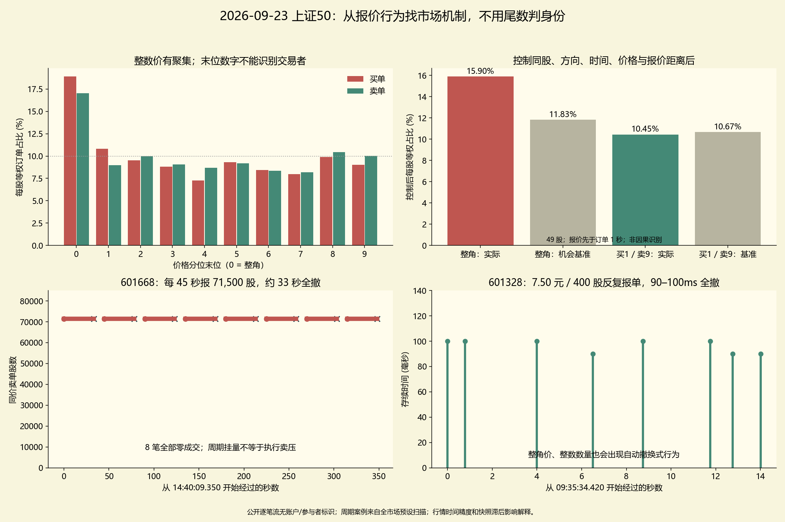

# 整数价、周期报单与撤换：可复现的当日行为研究

数据为 2026-09-23 上证50的逐笔委托、逐笔成交和快照；研究完成于 2026-10-15。图中的语音文字与同学结果提供研究问题，数值均由本项目重新计算，不把截图数字当作本地验证结果。

## 主要发现

**整数价位确有额外聚集，但这一天最鲜明的自动化式行为是周期报价与撤换，不是持续净买入或净卖出。**扫描选中的 22,368 笔周期订单里，99.27% 全部撤销、没有成交。大挂量和规则时钟都不能直接翻译成执行方向，更不能据此给订单贴个人或机构身份标签。



## 字段和样本口径

本研究覆盖 50 股，连续竞价有 **4,288,027 条 ADD**，不是全日所有原始申报。每笔 ADD 表示撮合后披露的剩余挂量；完全即时成交、没有剩余 ADD 的主动订单没有可观察的挂单限价，本研究不把成交价伪装成其申报价。

以 `(股票, Channel, OrderOriNo)` 关联 ADD、撤单和成交。`OrderNumber` 不作订单身份。按频道 `BizIndex` 比较成交在 ADD 前还是后。ADD 对应订单的总观察申报量为 `ADD.Volume + ADD 前该订单的成交量`。**84,082 条 ADD** 的数量需这样修复。ADD 后的成交和撤单合计不得超过 ADD 挂量，脚本发现超量或方向错误会中止。本轮未出现负剩余量。

原始委托属于限价还是市价转换残量、参与者账户、母单、接收时钟均未提供，因而“总观察申报量”不是原始订单类型和原始市价保护价的恢复。

数量、母序列和生命周期均由**事后完整数据关联**获得：在成交首先披露、剩余ADD稍后披露的场景中，原始申报当时尚不能知道它后来会不会留下ADD。补回数量不能回填到原始申报时刻作在线特征；最终撤单率、完整8笔周期、未来补单也不能提前交给策略。即便在ADD出现后可用先前已收取的成交补回该订单已知数量，本轮没有实现或验证这样的在线接收算法。此报告所有行为归纳均为离线诊断。

## 整数价位：控制可报价机会后仍有聚集

这里区分整角价（如 7.50、7.60）与整元价（7.00、8.00）。连续 ADD 原始统计按股票等权：买单整角占 **18.91%**，卖单占 **17.06%**。把理论基准直接设成 10% 会忽略股价自身在特定尾数停留的时间，不能据此量化全部偏好。

控制方式如下。每条 ADD 只使用标签至少早 1 秒、且年龄不超过 4 秒的历史快照，将相对同侧最好报价的距离限定为 0–20 ticks。按**同股、方向、5 分钟时段、精确报价距离、整数元价格区间**分层。每个快照在相同距离上的可报价尾数形成机会基准，然后用真实订单的分层数量权重重加权；要求分层至少 5 次快照、至少出现两种尾数。每股结果最后等权。601166 因前一轮识别的时间映射问题排除，只影响报价控制研究，事件模式扫描仍报告全部 50 股。

| 控制口径 | 样本 ADD | 整角实际占比 | 机会基准 | 超额 | 买分尾1/卖分尾9超额 |
|---|---:|---:|---:|---:|---:|
| 引用标签至少早0秒的报价 | 2,521,403 | 15.67% | 11.80% | +3.87个百分点 | −0.15个百分点 |
| 主口径：至少早1秒 | 2,381,316 | 15.90% | 11.83% | **+4.07个百分点** | **−0.22个百分点** |
| 至少早2秒 | 2,302,251 | 16.04% | 11.81% | +4.23个百分点 | −0.19个百分点 |

整角超额在 **48/49 股** 为正；买分尾1/卖分尾9超额仅 **21/49 股** 为正。所以整角拥挤在控制后仍存在，普遍“一分钱抢到整数价前面”的推断却没有得到支持。这不是因果识别：3秒快照可能已过时、时段内交易强度不均、报价时钟精度有限。控制只覆盖样本的报价距离和价位机会，未控制投资者动机，也不代表所有价格档位。

0/1/2秒仅是假设滞后的敏感性对照。没有真实接收时间，所以它不能替代交易者当时可观察信息的验证；也没有引用审计中向未来搜索得到的状态对齐。

外汇研究观察过整数聚集与买尾1/卖尾9的价格优先行为，但其市场制度和粒度变化与本数据不同，不能把该结论移植成 A 股投资者身份规则。[Lallouache 与 Abergel 的原论文](https://arxiv.org/abs/1307.5440)。台湾限价单研究使用真实投资者类型字段后才比较个人、基金等群体；我们的数据不含这些字段。[Chiao 与 Wang 的原论文](https://onlinelibrary.wiley.com/doi/10.1111/j.1540-6288.2008.00208.x)

## 周期模式：最强案例实际在撤换报价

预先固定扫描条件：同股、同方向、同总观察数量、同30分钟区块内连续8笔 ADD；7个间隔平均0.5–60秒、间隔变异系数≤3%，不要求价格相同。不调参最大化后续价格预测。

发现 **11,981 个重叠窗口**，抽取 **2,796 个组内不重叠案例**，其中主板60个。案例上午1,729个、下午1,067个；83.08% 的平均周期在2.99–3.01秒。每组抽取后不复用同一订单，但不同侧、不同数量组的案例仍可能属于同一公共模式，不能把2,796说成独立交易者或母单。

为诊断全市场扫描造成的选择偏差，保留所有真实时间点与各股各方向各30分钟数量分布，将数量标签打乱10次后运行同一扫描。10次均没有合格窗口。这个对照只说明数量与时钟的规则关联不能轻易由该随机化复现；不能证明同一账户、不能给出稳健的全市场显著性，更不能排除供应商时钟处理或其他共同机制。10次对照不足以支持细小p值。

实际案例一：**601668，14:40:09.350—14:45:24.340，4.29元卖单，每笔71,500股**。8笔间隔为44.990/45.010/45.000/45.000/45.000/45.000/44.990秒。订单ID为12637922、12677691、12713794、12750827、12788243、12825745、12865888、12910893，频道1005。每笔在32.990–33.010秒后全撤，8笔均无任何成交。因此这是高度规则的报价存续模式，不能叫已经实施的 TWAP 卖出拆单，也不能把8×71,500股当作实际卖出量。

实际案例二：**688981，11:05:04.360—11:05:25.360，1,100股卖单，严格每3秒刷新**，卖价122.20—122.31元。首笔 `1007:8012590` 在11:05:07.360全撤；下一笔 `1007:8014806` 同时出现，3秒后再全撤。11:05:22.360 存在相邻ID买单8025624和卖单8025625，买价121.19、卖价122.23；两者3秒后全撤。它具有双边定时刷新特征，与单方向执行不同。

选中周期订单共有22,368笔：99.29%观察到零成交，99.27%同时满足全部撤销且零成交。该比例是**本次扫描选中的周期订单**条件统计，不能扩大成全市场订单撤单率。

三个展示案例共24笔订单另行从原始Parquet提取，独立检查每个ID只有一个ADD、撤单全量、没有作为买方或卖方关联任何成交。逐笔原始业务序号和时间保存在 `selected_case_verification.json`。展示案例在全量扫描后为解释结果而选取，不是留出样本或身份标签。

## 整数数量也会误导

50股等权，100股订单占28.63%，100股整数倍占95.61%。但主板买单的整百要求本来就是制度约束；科创板允许200股起、以1股递增。小订单、整数数量均不能判定手工操作。[上交所交易机制](https://english.sse.com.cn/start/trading/mechanism/)、[科创板申报数量说明](https://edu.sse.com.cn/tib/qa/c/4866268.shtml)

六只科创板股中，非整百的总观察数量比例为27.09%–46.75%。周期报价中的数量中位数常见272、396、442、574等数字；对应报价金额却往往靠近整十万元：688008/688041/688111约10万元，688012约20万元，688256约30万元。详见 `periodic_quote_notionals.csv`。**股数不圆整，现金规模可能很圆整**，这比只看股数尾数更有解释力。不过这些现金水平是在发现周期案例后作的描述，属于探索性线索，不能当成预注册的身份检验。

双边定时报价、接近固定现金规模的数量与科创板提供双边持续报价、考核最小报价金额的机制相容；该制度事实来自做市细则第3、18条。我们的流中没有做市账户标识，不能据此确认任何具体订单属于做市商，也不能把10万/20万/30万说成此处已验证的具体监管门槛。[上交所科创板做市细则](https://www.sse.com.cn/lawandrules/sselawsrules2025/stocks/exchange/c/c_20250519_10779404.shtml)

反例：**601328，7.50元买400股，09:35:34.420—09:35:48.430反复出现，每次90–100毫秒后全撤**。首笔 `1004:1430447`，后续ID1432451、1440859、1447057、1452636、1459761、1463512、1468142。整角价格、整百股数与自动撤换式行为同时出现。另有28个快速同价同量报撤簇，各至少8笔30秒内出现，逐笔ID均保存在CSV。快速撤换是行为描述，未观察意图，不能称虚假申报、欺骗或操纵。

上交所对程序化交易的定义涉及指令是否由计算机生成或下达；我们没有执行系统记录或参与者标识，仅有行为线索。即便一个人使用程序下单，也不意味着他是机构。无法可靠挑出“明显个人交易”，且这种无法识别是数据边界，不是模型算力不足。[上交所所载程序化定义](https://www.sse.com.cn/home/component/news/c/c_20240515_10756054.shtml)。有会员ID的订单流研究才可将持续性分解到同一参与者和群体行为。[Tóth 等原论文](https://arxiv.org/abs/1108.1632)

## 把两段语音整理为可以研究的问题

第二图的可靠逻辑是：先测一档/多档盘口失衡、微价格、历史动量和成交强度与1–300秒未来中间价的关系；上午固定分组阈值或模型，下午检查分组排序；比较信号寿命；区分价格方向预测和绝对波动预测。图中约0.25的相关性、五分位梯度和12因子岭回归属于同学展示，未由本研究复算；不能把截图相关性当净利润。跨多个预测期限、重叠标签、同股共同波动、同日选择模型都会影响验证。真正值得借鉴的是明确问题、固定阈值、留出时间和解释机制。

第三图可拆成四个问题：1）低价股tick制度怎样影响相对价差和队列；2）订单流不平衡是同期关联还是向前预测；3）大成交发生在价格变化前还是后；4）整数价和整数现金预算如何影响报价存续。第一点已有本项目前轮证据；第二、三点须做严格事件先后和相同流动性对照，不能靠回忆K线推断“大单导致走势”或“国家队动作”。快速撤单不能叫假挂单；价格整数不能叫个人，定时序列不能叫同一机构。本轮重点实测了第四点。

## 最值得继续验证的策略机制

研究方向是**计划交易的报价选择和队列可持续性**：已决定买入固定股数时，区分长存续的整角队列、周期撤换的可见容量和真正成交执行流。当价差至少2 ticks时，改善1 tick可能改变优先级，但要同时计量多付的一分钱、逆向选择、费用和未完成风险；价差只有1 tick时不能合法插入中间价。

可以冻结三秒刷新/45秒撤换的识别规则，在后续日期实时识别，研究可见深度消失是否主要由撤单而非交易造成，并同价、同深度、同价差、同时间段比较执行完成率。**这是下一步可检验的机制假设，本轮没有提供该策略的净收益或跨日有效性。**本轮当日尾数聚集、规则撤换和现金预算特征成立，身份判定和可盈利套利未成立。

## 复现与文件

```powershell
# pandas/numpy/pyarrow 可用的运行环境
python order_patterns.py --data sse50_20260923 --out reports/order_patterns --null-runs 10
# 可在安装 matplotlib 的另一 Python 环境画图
python plot_order_patterns.py
```

本机分析使用 `python`；绘图使用默认 Python。没有修改原始Parquet，也没有运行同学的外部代码。

`summary.json`：总体计数、报价控制敏感性和模式条件统计；`stocks.csv`：逐股数量关联检查；`price_tails.csv`：各股各方向的尾数计数与股数；`exposure_controls.csv`：0/1/2秒报价滞后控制；`matched_strata.csv`：主口径全部分层；`periodic_counts.csv`：窗口数和置乱对照；`periodic_examples.csv`：全部2796个案例及22368笔ID、量、报价、成交/撤单；`periodic_quote_notionals.csv`：科创板报价现金规模；`rapid_cancel_examples.csv`：28个快速报撤簇；`selected_case_verification.json`：展示24笔订单的独立原始关联检查；`size_features.csv`、`lifecycle_descriptive.csv`：数量和存续描述，不将未经控制的组差异解释为因果。
